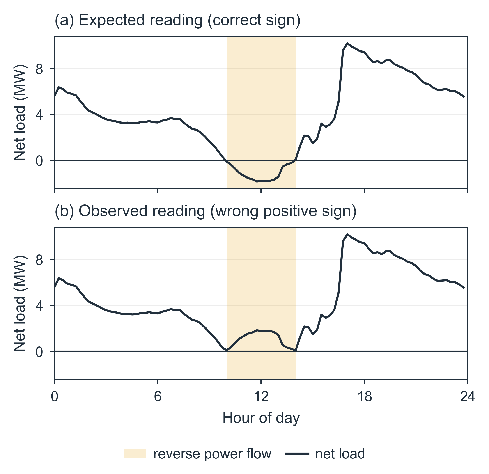

<section class="nrpf-landing">

<header class="nrpf-hero">
  
Python for Network Reverse Power Flow (PyNRPF)

  <h1>Some substations record only the power magnitude, not the direction.</h1>
  
Reverse power flow readings, which record electricity flowing from households
  back to the grid due to solar, look normal and pass the usual checks like missing data and
  outliers. However, they have the wrong sign and should have been read as negative. PyNRPF finds
  them and puts the sign right.

  

    <a class="nrpf-button nrpf-button--primary" href="overview/">Get started</a>
    <a class="nrpf-button" href="#how-it-works">How it works</a>
    <a class="nrpf-button" href="https://github.com/mssamhan31/PyNRPF">View on GitHub</a>
  

</header>

<section class="nrpf-section nrpf-split">
  

    
The problem

    <h2>When solar exports are read by electricity meters as imports</h2>
    
On a sunny, mild day, rooftop solar can produce more electricity than the homes and
    businesses around a substation use. The surplus flows back into the network. This is called
    reverse power flow, and a correct meter records it as negative: the day's trace dips below
    zero around midday.

    
Many older substation meters measure only how much power flows, not which way. They store
    the export as an import, so the trace touches zero and bounces back up instead of crossing
    it. Nothing looks broken, yet every one of those readings is wrong by twice its value.

  

  <figure class="nrpf-figure">
    
    <figcaption>The same day as it should be recorded (a) and as a magnitude-only meter records it
    (b). Shaded: the hours of reverse power flow. Anonymised substation data.</figcaption>
  </figure>
</section>

<section class="nrpf-section nrpf-facts">
  
Key facts

  <h2>A growing problem, hiding in plain sight</h2>
  

    
<strong>40%+</strong>of free-standing Australian homes have rooftop solar[1]

    
<strong>30 GW</strong>of rooftop solar installed across Australia[1]

    
<strong>8 of 200+</strong>Ausgrid substations found storing solar exports as imports in 2023[2]

    
<strong>34 MW</strong>change in the network's minimum demand once those readings were corrected (2.3%)[2]

    
<strong>8 MW</strong>largest correction to a single substation's minimum demand[2]

  

  
Ausgrid figures from the 2023 case study in the AUPEC 2026 paper, found with the
  earlier methods described there.

</section>

<section class="nrpf-section">
  
Why it matters

  <h2>A small sign with large consequences</h2>
  

    

      <h3>Reporting</h3>
      
Network businesses report historical demand to regulators, and those figures carry the
      error too.

    

    

      <h3>Forecasting</h3>
      
Net-load forecasts learn from history. Trained on wrong signs, they learn the wrong shape
      of a sunny day.

    

    

      <h3>Network planning and investment decisions</h3>
      
Networks rely on net-load forecasts for network planning, which informs their
      infrastructure investment decisions. Hidden exports make minimum demand look higher than it
      really is.

    

  

  
Upgrading the meters fixes future readings, but not the years of history already
  recorded. That history needs correcting.

  <h3>Not one network's problem</h3>
  
The limitation dates from equipment installed before rooftop solar was common, when power
  was expected to flow only from the grid to customers. The same metering limitation has been
  reported at Energy Queensland[3] and SA Power
  Networks[4], and a similar meter behaviour was documented in the
  United Kingdom[5].

</section>

<section class="nrpf-section" id="how-it-works">
  
How it works

  <h2>One physical idea, three possible decisions</h2>
  

    

      <h3>Look at each day on its own</h3>
      
PyNRPF reads one substation's fifteen-minute readings for one day, together with an
      estimate of how much solar the area generated.

    

    

      <h3>Test a flip</h3>
      
It tries every midday window and asks: if the sign were flipped here, would the
      underlying demand join up smoothly with the hours either side? Real demand changes
      smoothly; a wrong sign leaves a tell-tale bump.

    

    

      <h3>Weigh the evidence</h3>
      
The stronger the case for a flip, the higher the probability that the day was recorded
      wrongly.

    

  

  
&#8595;

  

    

      <h3>Correct automatically</h3>
      
Clear evidence of a wrong sign: the readings in the window are flipped.

    

    

      <h3>Ask a person</h3>
      
Not sure either way: the day goes to a reviewer, with the window PyNRPF suggests.

    

    

      <h3>Keep as recorded</h3>
      
No sign of an error: the day stays exactly as it was.

    

  

  
One setting decides how sure PyNRPF must be before it acts on its own, and so
  how many days go to a person.

</section>

<section class="nrpf-section">
  
Built for practice

  <h2>Made to run inside a network's data pipeline</h2>
  

    

      <h3>Original data untouched</h3>
      
Corrections are written alongside the recorded readings, which are never overwritten.

    

    

      <h3>Traceable</h3>
      
Every result records the software version and settings that produced it, so it can be
      reproduced exactly.

    

    

      <h3>Runs where the data lives</h3>
      
A Python package that works on a laptop or across a cluster, one substation at a time.

    

    

      <h3>No training needed</h3>
      
It works out of the box, and a few reviewed days are enough to tune it to a new
      network.

    

  

</section>

<section class="nrpf-section">
  
Research

  <h2>Grounded in peer-reviewed work</h2>
  
PyNRPF grows out of a PhD study at UNSW Sydney in partnership with Ausgrid. A conference
  paper accepted for AUPEC 2026 identifies the problem and tests two earlier methods on the
  Ausgrid network[2]. The current method is the subject of a journal
  article in preparation.

  

    <a class="nrpf-button" href="papers/">Papers and citation</a>
    <a class="nrpf-button" href="https://doi.org/10.5281/zenodo.18764943">Software DOI</a>
  

</section>

<section class="nrpf-section">
  
The team

  <h2>Who made it</h2>
  

    

      <h3>UNSW Sydney</h3>
      
M. Syahman Samhan, Anna Bruce and Baran Yildiz, School of Photovoltaic and Renewable
      Energy Engineering

    

    

      <h3>Ausgrid</h3>
      
Jaysson Guerrero Orbe, Navid Haghdadi and Daniel Sim, Demand Forecasting

    

  

  
PyNRPF is part of M. Syahman Samhan's PhD study, supported by the University
  International Postgraduate Award (UIPA) from UNSW and top-up scholarships from Ausgrid, RACE for
  2030 and the NSW Decarbonisation Innovation Hub. It is open source under the MIT licence.

</section>

<section class="nrpf-section">
  
References

  <ol class="nrpf-references">
    <li>IEA Photovoltaic Power Systems Programme, "Australia: 2025 country update."
    <a href="https://iea-pvps.org/about-iea-pvps/members/australia/">https://iea-pvps.org/about-iea-pvps/members/australia/</a></li>
    <li>M. S. Samhan, J. Guerrero Orbe, N. Haghdadi, D. Sim, A. Bruce and B. Yildiz, "Reverse power
    flow sign correction for meter-limited substation data," accepted for the Australasian
    Universities Power Engineering Conference (AUPEC), November 2026.</li>
    <li>F. Geth, M. Vanin, W. Van Westering, T. Milford and A. Pandey, "Making distribution state
    estimation practical: challenges and opportunities," arXiv:2311.07021, 2023.
    <a href="https://arxiv.org/abs/2311.07021">https://arxiv.org/abs/2311.07021</a></li>
    <li>Australian Energy Market Operator, "South Australian under frequency load shedding, dynamic
    arming: implementation investigation," 2021.
    <a href="https://www.aemo.com.au/-/media/files/initiatives/der/2021/south-australian-ufls-dynamic-arming.pdf">aemo.com.au</a></li>
    <li>Office of Gas and Electricity Markets, "Single phase import meters operating under export
    conditions, manufacturer poll: summary of responses received December 2003," 2003.
    <a href="https://www.ofgem.gov.uk/sites/default/files/docs/2004/01/5560-manufacturer_poll_response_summary.pdf">ofgem.gov.uk</a></li>
  </ol>
</section>

</section>
